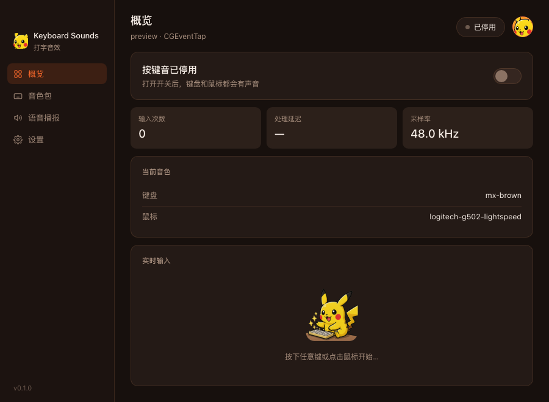
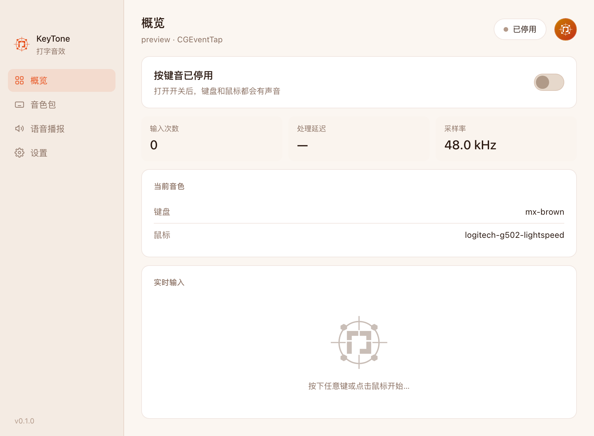
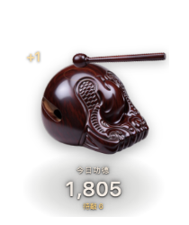

# KeyTone

> 打字即演奏 —— 一个常驻菜单栏的键盘 / 鼠标音效引擎。

把每一次敲击和点击都变成声音：机械轴的清脆、打字机的咔哒、老式薄膜键盘的闷响。
声音在内存里预解码，按下到出声的延迟控制在 10ms 级别，打字时不会有"音画不同步"的迟滞感。



| 深色 | 浅色 |
|---|---|
|  |  |

---

## 特性

**声音**

- 键盘与鼠标各自独立的音色包，可分别切换
- 每个键位可绑定专属音色；同一个键支持多个采样变体，播放时随机挑选，避免重复感
- 峰值归一化：不同音色包的录音电平差异最大能到 10 倍，加载时统一归一到接近满刻度，
  切包不会再出现"这个听不见、那个炸耳朵"
- 试听：选中音色包立即播放，也可以单独点「试听」按钮，全程不需要系统权限
- 内置 21 个音色包：19 个真实录音采样包编译进二进制，另有 2 个在启动时用波形合成

**系统集成**

- 全局捕获键盘与鼠标（含修饰键、侧键），在任何应用里都生效
- 常驻菜单栏（不占 Dock），点关闭只是收进托盘，不退出进程
- 关闭窗口时销毁 WebView 而不只是隐藏，常驻内存明显下降
- 深色 / 浅色 / 跟随系统三档主题，菜单栏图标支持单色模板与品牌金两种样式
- 键位语音播报（中 / 英），用系统 TTS 实时合成，不预生成音频文件
- 检查更新：读取 GitHub Releases 比对版本

**避免打扰**

- 本应用窗口在前台时不发声 —— 你点自己的界面、在自己的窗口里打字，不该被自己的音效吵到
- 语音只在按下时播报，抬起不重复；快速打字时打断上一句，保证读的是最新按下的键

**木鱼**



- 菜单栏一项「木鱼」独立开关，和按键音互不影响，可以只开木鱼不开音效
- 每次按键 / 点击只**攒库存**，不出声。**第一笔待敲出现 2 秒后**开始结算，然后每 **500ms**
  匀速敲一下（150–2000ms 可调），敲一下库存减一、功德加一 —— 和键盘音的时间轴天然错开
- 桌面右下角一个透明置顶、点击穿透的挂件：木鱼挤压、木槌甩回、功德 +1 上浮
- 挂件能拖动、能缩放（70%–150%）、能单独隐藏；跟着你切桌面走（全屏应用除外）
- 木鱼和木槌是两张透明底 PNG，换掉就能用自己的图；附一个可视化调参页
- 功德按本地日期跨天清零，数据落在 `muyu.json`

---

## 技术栈

| 层 | 选型 |
|---|---|
| 应用框架 | Tauri 2 |
| 后端 | Rust（2021 edition） |
| 前端 | 单文件静态 HTML + 原生 CSS/JS，无框架、无构建步骤 |
| 音频 | rodio / cpal |
| 输入捕获 | macOS `CGEventTap` |
| 语音 | `AVSpeechSynthesizer` |

前端是 `dist/index.html` 一个纯静态页，编译期由 Tauri 内嵌进二进制。
**不需要 `npm install`，也不需要打包前端** —— 改完 HTML 直接 `cargo build` 即可。

---

## 快速开始

需要 Rust 1.77+，macOS 13+ 或 Windows 10+。

```sh
git clone https://github.com/PikachuGits/keytone.git
cd keytone/src-tauri
cargo build --release
```

先单独验证音频链路（不需要任何系统权限，会依次播放一组按键声）：

```sh
./target/release/keytone --selftest
```

Windows 上是 `target\release\keytone.exe --selftest`。

然后启动应用，点右上角开关启用。

### 首次使用要授权

macOS 不允许应用静默监听全局输入，必须手动开启辅助功能权限：

1. 启动应用，点开关
2. 系统弹出授权提示，前往「系统设置 → 隐私与安全性 → 辅助功能」
3. 勾选 KeyTone
4. 回到应用，再点一次开关

> **每次重新编译后授权都会失效** —— TCC 认的是二进制签名，重新编译签名就变了。
> 日常使用建议 `cargo build --release` 一次之后不要再重编，否则每次都要重新勾选。

### 授权了却一直显示「未授权」？

按顺序排查：

1. **确认 app 是被签名过的**。TCC 的辅助功能授权必须绑定一个稳定的代码签名身份，
   `.app` 包如果没有签名（只有内层可执行文件带链接器的 ad-hoc 签名），
   系统无法把授权和这个 app 关联起来，勾选后 `AXIsProcessTrusted()` 依然返回 false。

   ```sh
   codesign --verify --verbose=2 /Applications/KeyTone.app
   # 正常输出：valid on disk / satisfies its Designated Requirement
   ```

   如果报 `code object is not signed at all`，说明构建时没签名 —— 本仓库的
   `tauri.conf.json` 里 `bundle.macOS.signingIdentity` 设为 `"-"` 即可，CI 也会在
   发布前校验签名，未签名直接失败。

2. **删掉旧条目重新添加**。签名变了（比如重装、重新编译）之后，
   系统设置里的旧勾选会变成僵尸条目，指向一个已经不存在的签名。
   在「辅助功能」列表里选中 KeyTone，点「−」删掉，再点「＋」重新添加 `/Applications/KeyTone.app`。

3. **确认没有跑在 DMG 里**。直接从磁盘映像双击运行会触发 App Translocation，
   系统会把它挂到一个随机临时路径下，授权绑在那个路径上，下次启动就失效。
   必须先拖进 `/Applications` 再运行。

4. 授权后**切回应用会自动刷新**（应用每 1.5 秒复查一次），不需要重启。

---

## 命令行

```sh
keytone --selftest                      # 音频链路自检，不需要权限
keytone --check-profiles                # 校验所有音色包，打印峰值与归一化增益
keytone --preview keyboard [包名]       # 命令行试听键盘音色包
keytone --preview mouse    [包名]       # 命令行试听鼠标音色包
keytone --speak zh "左键"               # 验证语音播报
keytone --import-profiles <目录>        # 批量导入外部音色包并逐个校验
keytone --muyu-selftest                 # 木鱼链路自检：进队列 → 等 2s → 匀速敲出 → 落盘
keytone --muyu-window                   # 只弹木鱼挂件，用来单独调窗口外观
keytone --muyu-window --hits 6 --scale 1.3   # 弹挂件并模拟 6 次敲击，1.3 倍大小
keytone --muyu-window --drag-test       # 弹挂件并直接进入拖动模式，验证拖拽链路
```

`--check-profiles` 的输出形如：

```
logitech-g915-tkl-brown    keyboard  10 音源  20 采样  峰值 0.129 → 增益 7.38x
mx-brown                   keyboard   8 音源  16 采样  峰值 0.301 → 增益 3.16x
```

---

## 音色包

存放位置：

```
macOS    ~/Library/Application Support/com.keytone.app/profiles/
Linux    ~/.local/share/com.keytone.app/profiles/
Windows  %APPDATA%\com.keytone.app\profiles\
```

界面里点「打开目录」可直接跳转。每个音色包是一个子目录，里面放 `profile.yaml` 和音频文件。

### 格式

采用 MechVibes 风格的 YAML 结构：

```yaml
profile:
  name: my-keyboard
  author: your-name
  description: 我的键盘

sources:
  - id: key1
    source:
      press: press_key1.wav
      release: release_key.wav

keys:
  default: [ key1 ]
  other:
    - sound: enter
      keys: [ enter ]
```

在此基础上扩展了一点：`press` / `release` 可以写成**列表**，表示同一个键的多个采样变体，
播放时随机挑一个，长时间打字不会听出明显的循环感：

```yaml
    source:
      press: [ press_key1.wav, press_key2.wav, press_key3.wav ]
```

支持 `.wav` / `.mp3` / `.flac` / `.ogg`。

### 鼠标音色包

把 `keys` 换成 `buttons`，按钮名是 `left` / `right` / `middle`：

```yaml
profile:
  name: my-mouse
  device: mouse

sources:
  - id: click
    source:
      press: click.wav
  - id: right_click
    source:
      press: right.wav

buttons:
  default: click
  other:
    - sound: right_click
      buttons: [ right ]
```

也兼容 MechVibes 的数字键写法（`'1'` 左键 / `'2'` 中键 / `'3'` 右键），两种都会正确映射。
`device` 字段可以省略 —— 有 `buttons` 没有 `keys` 会自动推断为鼠标包。

鼠标目前只播放按下音（一次点击一个咔哒），滚轮暂不支持。

---

## 目录结构

```
src-tauri/src/
├── main.rs        # 入口、IPC command、托盘、事件消费线程
├── audio.rs       # 音频线程（cpal 的 Stream 是 !Send，必须独占线程）
├── profile.rs     # 音色包解析、解码、峰值归一化
├── synth.rs       # 内置合成音色包生成
├── keymap.rs      # 虚拟键码 → 规范键名
├── config.rs      # 设置持久化
├── speech.rs      # 语音播报
├── bundled.rs     # 内置音色包安装
├── muyu.rs        # 木鱼：库存队列、结算线程、功德落盘
└── hook/
    ├── mod.rs     # 平台抽象
    ├── macos.rs   # CGEventTap + 辅助功能授权
    ├── windows.rs # WH_KEYBOARD_LL
    └── linux.rs   # evdev
```

前端在 `dist/`：`index.html` 是主界面，`muyu.html` 是桌面挂件，
`muyu-tuner.html` 是调参页（滑杆改布局、导出 JSON）。

数据目录里 `settings.json` 保存音量、启用的音色包、主题、菜单栏样式、木鱼配置等；
`muyu.json` 存今日 / 累计功德；`muyu/` 下是两张可替换的挂件素材。

---

## 实现笔记

开发过程中几个不太显然的点，记下来省得下次再踩：

1. **`cpal::Stream` 在 macOS 上是 `!Send`** —— 音频设备不能跨线程持有，
   必须独占一个线程，外部通过 channel 下指令。
2. **rodio 的默认缓冲可能开不了流** —— 它按 `sample_rate / 20` 算缓冲（48kHz 下是 2048 帧），
   而部分设备的合法区间只有几百帧。需要按 `[480, 960, 256, 240]` 逐个降级试，480 帧正好 10ms。
3. **`CGEventTap` 的修饰键走 `FlagsChanged`** —— 不能当 keyDown 处理，
   必须读 flag 位判断按下还是抬起，否则 Shift / Cmd 会一直被判为按下。
4. **`AXIsProcessTrusted()` 永远不会弹授权框** ——
   必须用 `AXIsProcessTrustedWithOptions` 配 `kAXTrustedCheckOptionPrompt`。
5. **菜单栏图标被系统强制缩放到 18pt 高** —— 提高 PNG 分辨率不会让图标变大，
   只会变糊。想让图形占满画框，只能收紧 SVG 的 `viewBox`。
6. **`generate_context!` 会读 `icons/icon.png`** —— 缺这个文件直接编译失败。

---

## 平台支持

| 平台 | 状态 | 说明 |
|---|---|---|
| macOS | ✅ 已实机验证 | 键盘 / 鼠标捕获、语音播报全可用 |
| Windows | ✅ 已实现，CI 编译与单测通过 | 键盘 / 鼠标捕获可用；**语音播报暂不支持** |
| Linux | ⚠️ 代码已写，未验证 | evdev，需要 `input` 组权限 |

### Windows

不需要任何授权 —— 低级键盘钩子（`WH_KEYBOARD_LL`）装好就能用，
不像 macOS 那样要手动开辅助功能。

- 安装包：Release 里的 `.msi` 或 `-setup.exe`，二选一
- 数据目录：`%APPDATA%\com.keytone.app\`
- 键盘钩子和鼠标钩子（`WH_MOUSE_LL`）装在同一个线程，共用消息循环
- 左右修饰键靠扫描码和扩展位区分，所以 `LeftShift` / `RightShift` 是不同的音色

**语音播报在 Windows 上不可用**。macOS 用的是系统 `AVSpeechSynthesizer`，
Windows 需要接 SAPI（COM），还没做。界面会直接把语音入口隐藏，
不会留一个点了没反应的开关。

### 键名映射

音色包里的键名（`a` / `space` / `enter` / `leftshift`）是跨平台统一的，
但底层虚拟键码各平台完全不同：

| 平台 | 键码来源 |
|---|---|
| macOS | Carbon 虚拟键码（`0x00` = A） |
| Windows | `VK_*` 常量（`0x41` = A） |
| Linux | evdev 键码（`KEY_A`） |

`src-tauri/src/keymap.rs` 按平台分表，新增平台只需要补一张表。

---

## 开发

```sh
cd src-tauri
cargo build        # 调试构建
cargo test         # 单元测试
cargo run          # 启动
```

### 打包与发布

打一个 `v` 开头的标签推上去，GitHub Actions 会自动构建 macOS 通用二进制
（Apple Silicon + Intel）并创建 Release：

```sh
git tag v0.1.0
git push origin v0.1.0
```

产物会挂在 Release 页面下：

| 平台 | 文件 |
|---|---|
| macOS | `KeyTone_<版本>_universal.dmg`（Apple Silicon + Intel 通用） |
| Windows | `KeyTone_<版本>_x64_en-US.msi` / `KeyTone_<版本>_x64-setup.exe` |

两个平台并行构建，macOS 那份会先做签名校验再上传。

推送标签前记得先把 `src-tauri/tauri.conf.json` 和 `src-tauri/Cargo.toml` 里的
`version` 改掉——应用内的版本号来自 `Cargo.toml`。

### 用自签名证书保住辅助功能授权

默认的 ad-hoc 签名有个烦人后果：TCC 把授权绑定在 **cdhash** 上，
每次重新编译 cdhash 都变，你就得重新去系统设置里勾一遍辅助功能。

解决办法是给本机做一张**自签名代码签名证书**。签完之后 designated requirement 变成：

```
identifier "com.keytone.app" and certificate root = H"533f0e70..."
```

绑定的是证书而不是 cdhash，重新编译、重装都不会让授权失效 —— **只需授权一次**。

```sh
./scripts/make-signing-cert.sh    # 生成并导入证书（只需跑一次）
./scripts/build-macos.sh          # 之后都用这个脚本打包
```

`build-macos.sh` 会自动检测证书，找不到就回退到 ad-hoc 并提示。

原理与注意点：

- 证书必须带 `extendedKeyUsage=critical,codeSigning`，否则 `codesign` 不认这个身份
- 导出 PKCS12 时必须加 `-legacy`。OpenSSL 3 默认用 AES-256，
  而 macOS 的 `security import` 不认，会报 `MAC verification failed`
- 导入后还要 `security add-trusted-cert`，否则 `find-identity -p codesigning` 看不到它
- 这个证书只在本机有效，所以**没有写进 `tauri.conf.json`**（否则别人 clone 下来会打包失败）。
  本地靠 `APPLE_SIGNING_IDENTITY` 环境变量注入，CI 仍走 ad-hoc。
  想让 CI 也用同一张证书，把 p12 和密码放进仓库 Secrets
  （`APPLE_CERTIFICATE` / `APPLE_CERTIFICATE_PASSWORD` / `APPLE_SIGNING_IDENTITY`）即可。


### 检查更新

应用内「设置 → 更新」默认指向本仓库的 Releases，点「检查更新」会读
`https://api.github.com/repos/PikachuGits/keytone/releases/latest` 并和本地版本逐段比对。

流程分三步，每一步都要用户确认：

1. **发现新版本** → 显示版本号变化，问「是否现在下载」
2. **正在下载** → 进度条 + 已下载 / 总大小
3. **下载完成** → 选「更新并重启」或「稍后更新」

「稍后更新」不会重新下载：安装包留在数据目录的 `updates/` 下，
下次再走一遍流程会直接命中缓存跳到第 3 步。

**只在用户主动点「检查更新」时才弹窗**，启动和打开窗口都不会自动检查。

实现细节：

- 更新源、版本比对、下载全部用系统 `curl`，没有引入 HTTP 依赖
- 按平台挑安装包：macOS 认 `.dmg`，Windows 优先 `-setup.exe` 再退 `.msi`
- macOS 的「更新并重启」是**自己替换自己**：不能在自己还跑着的时候删掉自己的包，
  所以先把新包 `ditto` 到临时目录，写一个延迟脚本，退出进程后由脚本
  `rm -rf` + `ditto` + `open` 完成替换并重新拉起
- Windows 直接运行下载好的安装程序，然后退出当前进程

> 该功能读的是 **已发布** 的 Release，草稿状态不会返回。
>
> 用 CI 产出的包更新后，**macOS 的辅助功能授权需要重新勾选一次** ——
> CI 是 ad-hoc 签名，和本地自签名证书不是同一个身份。
> 想避免的话用 `./scripts/build-macos.sh` 本地构建覆盖安装。

---

## 许可

代码以 MIT 许可发布，详见 [LICENSE](LICENSE)。

内置音色包中的音频素材来自第三方开源项目，按 MIT 许可使用，
版权归属与许可全文见 [THIRD-PARTY-NOTICES.md](THIRD-PARTY-NOTICES.md)。
